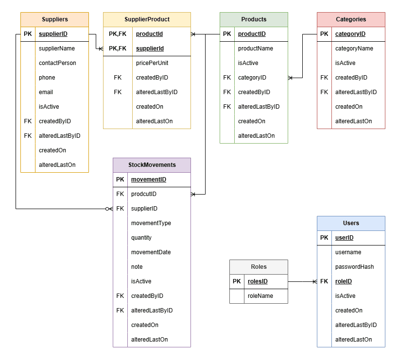

# Warehouse Management System

## Entity Relationship Diagramm (ERD)


> [!NOTE]
> The relationships for the **audit attributes** (`createdByID` and `alteredByID`) are not displayed to avoid visual clutter. Each `createdByID` and `alteredByID` is a FK connected to the `Users.userID` field.

## Icons
<a href="https://www.flaticon.com/free-icons/search" title="search icons">Search icons created by Catalin Fertu - Flaticon</a>
<a href="https://www.flaticon.com/free-icons/plus" title="plus icons">Plus icons created by Fuzzee - Flaticon</a>
<a href="https://www.flaticon.com/free-icons/pencil" title="pencil icons">Pencil icons created by alkhalifi design - Flaticon</a>
<a href="https://www.flaticon.com/free-icons/close" title="close icons">Close icons created by ariefstudio - Flaticon</a>
<a href="https://www.flaticon.com/free-icons/refresh" title="refresh icons">Refresh icons created by Arkinasi - Flaticon</a>
<a href="https://www.flaticon.com/free-icons/export" title="export icons">Export icons created by Shashank Singh - Flaticon</a>
https://smallpngtools.com/change-png-color.php
<a href="https://www.flaticon.com/free-icons/user" title="user icons">User icons created by Magnific - Flaticon</a>
<a href="https://www.flaticon.com/free-icons/logout" title="logout icons">Logout icons created by Pixel perfect - Flaticon</a>
<a href="https://www.flaticon.com/free-icons/password" title="password icons">Password icons created by Pixel perfect - Flaticon</a>
<a href="https://www.flaticon.com/free-icons/price" title="price icons">Price icons created by Magnific - Flaticon</a>
<a href="https://www.flaticon.com/free-icons/supplier" title="supplier icons">Supplier icons created by Slameticon - Flaticon</a>
<a href="https://www.flaticon.com/free-icons/categories" title="categories icons">Categories icons created by Creatype - Flaticon</a>
<a href="https://www.flaticon.com/free-icons/user" title="user icons">User icons created by Dreamstale - Flaticon</a>
<a href="https://www.flaticon.com/free-icons/warehouse" title="warehouse icons">Warehouse icons created by kawalanicon - Flaticon</a>
https://www.magnific.com/author/atif-arshad/icons -  Inbox + Outbox
https://www.magnific.com/icon/filters_17445778#fromView=search&page=1&position=8&uuid=b79c5de2-6f41-40af-81f1-7a19d64aa56c

## Project Structure
```
.
├── database-scrips         # sql scripts for tables and sample data
├── screenshots             # images used in README
└── README.md       
```