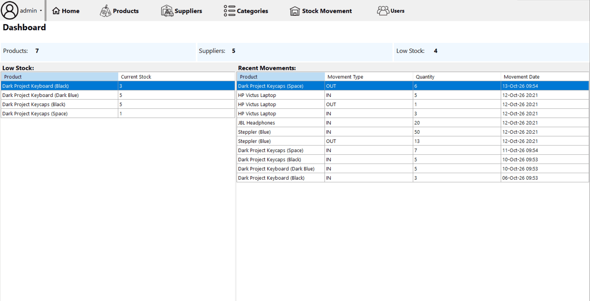
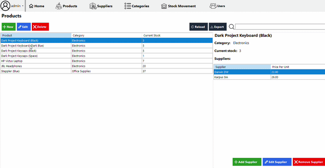
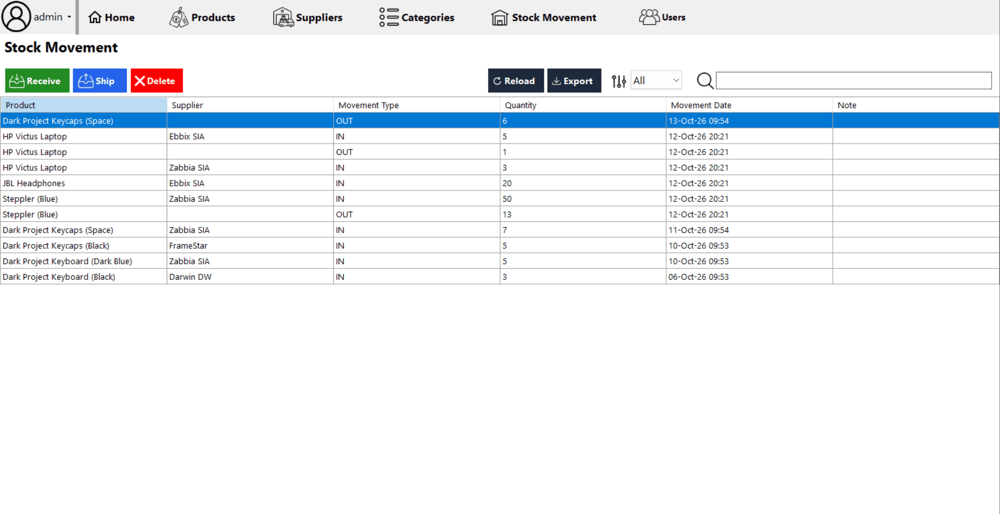
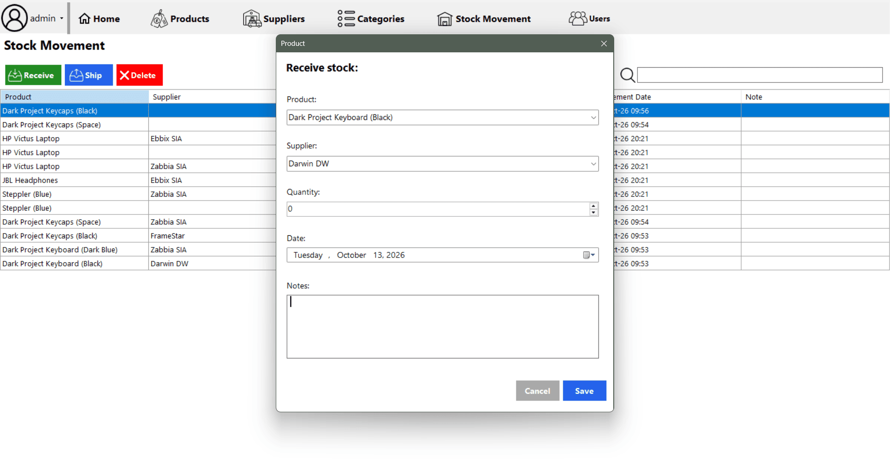

# Warehouse Management System

<div align="center">

[](#) [](#)

</div>

## Overview

A desktop warehouse management application built with **C# WinForms** and **SQL Server** with role-based access and soft-delete with audit trails.

Built as a personal project to practice C#, WinFowms, T-SQL, and layered architecture.

### Entity Relationship Diagram (ERD)


> [!NOTE]
> The relationships for the **audit attributes** (`createdByID` and `alteredByID`) are not displayed to avoid visual clutter. Each `createdByID` and `alteredByID` is a FK connected to the `Users.userID` field.

### Screenshots:

#### Dashboard (home view):


#### Products:


#### Stock Movements:


#### Receive stock (dialog):


### Features:
- CRUD functionality for all tables, e.g., product CRUD, supplier CRUD.
- Many-to-Many supplier <-> product links with per-supplier pricing.
- Soft delete with restore prompts and filtered unique indexes.
- Role-based UI (Admin, Warehouse Worker, Accountant).
- Search, filter, and CSV exports.

## Tech Stack
- C# / .NET Framework 4.8
- Windows Forms
- SQL Server (Express)
- BCrypt password hashing
- LINQ for in-memory filtering

## Setup
1. Run `database-scrips/01_create_scripts.sql` in SSMS.
2. Run `database-scrips/02_insert_sample_data.sql` to seed sample data.
3. Open the solution in Visual Studio, update the connection string in `App.config` if needed.

**Default login:** `admin` / `hash_123`

## Project Structure
```
.
├── /database-scrips         # sql scripts for tables and sample data
├── /icons                   # icons used in the application
├── /screenshots             # images used in README
├── /WarehouseManagementSystem
|    ├── /Data               # repositories (one per table)
|    ├── /Forms              # forms and dialogs
|    ├── /Helpers            # password hashing
|    ├── /Models             # POCO classes
|    ├── /Properties
|    ├── /Resources          
|    ├── /Session            # logged-in user state
|    ├── /Views              # user controls embedded in the main window
|    ├── App.config
|    ├── Program.cs
|    ├── WarehouseManagementSystem.csproj
|    ├── WarehouseManagementSystem.slnx
|    ├── packages.config
├── .gitignore
└── README.md       
```

## Icons
Icons used in this project:
- <a href="https://www.flaticon.com/free-icons/search" title="search icons">Search icons created by Catalin Fertu - Flaticon</a>
- <a href="https://www.flaticon.com/free-icons/plus" title="plus icons">Plus icons created by Fuzzee - Flaticon</a>
- <a href="https://www.flaticon.com/free-icons/pencil" title="pencil icons">Pencil icons created by alkhalifi design - Flaticon</a>
- <a href="https://www.flaticon.com/free-icons/close" title="close icons">Close icons created by ariefstudio - Flaticon</a>
- <a href="https://www.flaticon.com/free-icons/refresh" title="refresh icons">Refresh icons created by Arkinasi - Flaticon</a>
- <a href="https://www.flaticon.com/free-icons/export" title="export icons">Export icons created by Shashank Singh - Flaticon</a>
- <a href="https://www.flaticon.com/free-icons/user" title="user icons">User icons created by Magnific - Flaticon</a>
- <a href="https://www.flaticon.com/free-icons/logout" title="logout icons">Logout icons created by Pixel perfect - Flaticon</a>
- <a href="https://www.flaticon.com/free-icons/password" title="password icons">Password icons created by Pixel perfect - Flaticon</a>
- <a href="https://www.flaticon.com/free-icons/price" title="price icons">Price icons created by Magnific - Flaticon</a>
- <a href="https://www.flaticon.com/free-icons/supplier" title="supplier icons">Supplier icons created by Slameticon - Flaticon</a>
- <a href="https://www.flaticon.com/free-icons/categories" title="categories icons">Categories icons created by Creatype - Flaticon</a>
- <a href="https://www.flaticon.com/free-icons/user" title="user icons">User icons created by Dreamstale - Flaticon</a>
- <a href="https://www.flaticon.com/free-icons/warehouse" title="warehouse icons">Warehouse icons created by kawalanicon - Flaticon</a>
- <a href="https://www.magnific.com/author/atif-arshad/icons" title="inbox and outbox icons">Inbox & Outbox icons created by atif-arshad - Magnific</a>
- <a href="https://www.magnific.com/icon/filters_17445778#fromView=search&page=1&position=8&uuid=b79c5de2-6f41-40af-81f1-7a19d64aa56c" title="filter icon">Filter icon created by whocon - Magnific</a>
<a href="https://icons8.com/icon/83326/home" title="home icon">Home icon - Icons8</a>

Some icons original colors where changed from black to white using `https://smallpngtools.com/change-png-color.php` tool.